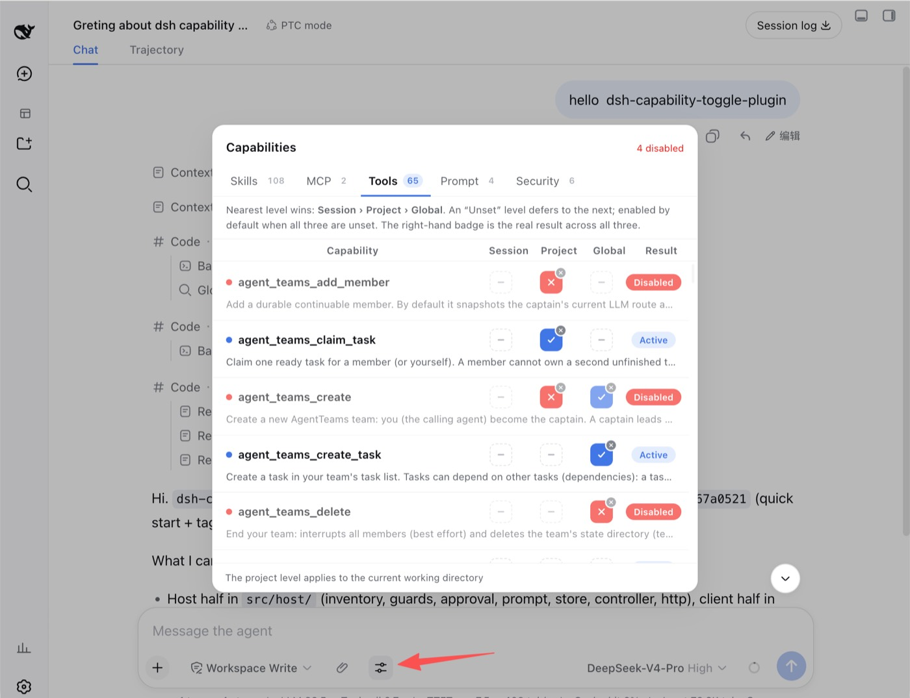

<div align="center">

# dsh-capability-toggle-plugin

**Control agent capabilities from the DSH WebUI — with real runtime enforcement.**

[](#quick-start)

[](https://github.com/lifeopsgo/dsh-capability-toggle-plugin/releases)
[](./LICENSE)

**English** · [简体中文](./README.zh-CN.md)



<sub>Session · Project · Global — blue check = on, red cross = off, dashed dash = unset.</sub>

</div>

## What it is

A **DeepSeek Harness (DSH) WebUI** plugin for controlling **skills, MCP servers, tools, prompt injections, approval escalation, and safety guards** at session, project, or global scope. Depending on the family, disabling removes, suppresses, rejects, or intercepts the capability on the agent's next step.

## Compatible DSH versions

This release targets **DSH 0.2.0-rc.1**. Every DSH peer dependency is pinned to that
release candidate. The Host uses the `agent/created` lifecycle, persistent
`configEditor` edits, and Loader volatile-config updates; each committed change
reconciles every live agent binding.

| DSH version | Status | How it was checked |
| --- | --- | --- |
| 0.2.0-rc.1 | supported | Host and Client typechecks, 380 automated tests, production build, framework-link validation, composed-profile inspection, and browser verification |

This release makes no compatibility claim for other DSH versions.

## Quick start

Requires **Node.js ^22.19.0 or ≥ 24.0.0** (same as DSH 0.2.0-rc.1).

```bash
dsh plugin --profile web add github:lifeopsgo/dsh-capability-toggle-plugin#v2.0.1
```

Restart the existing DSH Web GUI process, then refresh the page. Start it with the command below when it is stopped:

```bash
dsh --profile web web
```

Open the control beside the ➕ button while the agent is idle. Replace `web` with another profile name when needed.

<details>
<summary>Upgrade or remove</summary>

```bash
# Upgrade or downgrade: use any tag listed on the releases page
dsh plugin --profile web add github:lifeopsgo/dsh-capability-toggle-plugin#v2.0.1

# Remove
dsh plugin --profile web remove dsh-capability-toggle-plugin
```

</details>

## Features

### Three-level resolution

Each capability has three independent levels:

```text
session  ›  project  ›  global  ›  default (enabled)
```

The nearest explicit value wins. **Unset** defers to the next level; with every level unset, the capability remains enabled. The row badge always shows the resolved result.

The button displays only its current state: click to toggle **on ↔ off**, or use its small clear badge to return to **unset**.

### Capability families

| Tab | Controls |
| :-- | :-- |
| **Skills** | Individual model-invocable skills, including project-level skills discovered from the session's workspace (`.dsh/skills`, `.agents/skills`) |
| **MCP** | MCP servers; expand a row to inspect member tools |
| **Tools** | Individual model-visible tools and their guidance sections |
| **Prompt** | A safe, presence-checked allowlist of prompt injections |
| **Security** | Approval escalation and five opt-in safety guards |

### Enforcement

Every mechanism is scoped to the current agent; global registrations are not mutated.

| Family | Enforcement |
| :-- | :-- |
| `tool` | Removed with `ctx.tools.restrict({ deny })`; forced calls are refused, and the tool's `tool:<name>` guidance section is shadowed out of the prompt |
| `mcp` | Member tools removed with `ctx.tools.restrict({ deny })`; the server's `mcp:<server>` instructions section (its `### MCP server: <name>` block, including directives like "call kb.recall first") is shadowed out of the prompt, and shared resource calls (`list_mcp_resources` / `list_mcp_resource_templates` / `read_mcp_resource`) naming the switched-off server are refused |
| `skill` | Shadowed by a same-named `modelInvocable:false` runtime skill |
| `prompt` | Shadowed with empty text, or suppressed with `suppressRuntimeContext()` |
| `approval` | Scoped approval requests resolve to `rejected` |
| `guard` | `tools/pre-execute` blocks or requests confirmation for matching calls |

### Security controls

Turning off **Approval escalation** rejects every approval request from that agent without changing the system `/permission` setting.

Safety guards are opt-in:

| Guard | Action |
| :-- | :-- |
| Read-only mode | Block file writes, creates, and edits |
| Protect secrets | Block access to common secret files and credentials |
| Dangerous shell | Confirm high-risk shell commands |
| Destructive git | Confirm history- or work-losing git commands |
| Outbound network | Confirm network tools and outbound shell actions |

### Usage stats

Skills, MCP servers, and tools carry a small badge showing how many times the model called them this session (`called 7`). Counts update when a turn ends while the panel is open, live for one agent's lifetime, and are never persisted — the same retention as a safety guard's `matched N` badge.

The tally counts **requests**, not successful runs: a call a guard blocked or sent to confirmation still counts, because the model asking for a capability is the signal worth seeing. Guards are matched against rather than called, so they keep their own badge and show no usage count; prompt and approval rows show none either.

### Panel preferences

A disclosure arrow beside the panel title opens three display preferences, stored in `localStorage` so they survive page reloads and restarts:

| Preference | Effect |
| :-- | :-- |
| **Show “enabled / total” on tabs** | Renders each tab badge as a fraction (`67/106`) instead of a bare total, so the strip reports how much of each family is active at a glance. The tooltip states both numbers in words either way. |
| **Show call stats** | Hides or shows the per-row usage badge described above. |
| **Level columns to show** | Narrows the grid to Session, Session + Project, or all three columns. |

The fraction counts a guard as enabled only while it is **active**. A guard row reuses the same `disabled` field to mean ACTIVE — the inverse of every default-on family — so a Security tab with the approval gate open and all five guards inactive reads `1/6`, not `6/6`.

Narrowing the level columns is **display-only**: the three-level resolution keeps running exactly as before, so a hidden project or global override still applies. Each row's badge and level switches always reflect the resolved state — a default-on family reads `Active`/`Disabled`, a guard reads `Guarding`/`Inactive` — which is why hiding a column cannot hide an effect. The name column absorbs the freed width, and the layout is driven by CSS variables so it stays aligned with the narrow-screen adaptation.

Additional behavior: while the agent runs, the controls that write a stance lock — each row's level switches, their clear badges, and the bulk menus — but browsing stays open, so the search box, the level-column selector, the tabs, and a row's expand still work. State survives popup close and turn boundaries, and the UI follows the WebUI language.

## Roadmap

Planned, not yet implemented:

- **Cross-project config sync** — copy or link project-level settings from another project instead of configuring each project from scratch.
- ~~**Capability invocation stats**~~ — shipped in v1.2.0: skills, MCP servers, and tools badge how many times the model called them this session.
- ~~**Fraction-format tab counts**~~ — shipped in v1.3.0: each tab badge renders as `enabled / total`, and the panel's disclosure arrow holds three display preferences. A guard counts as enabled only while active, so its inverted `disabled` flag never inflates the Security numerator.
- **Settings menu for customizable defaults** — expose the plugin's own options in a settings menu, such as the default stance for newly discovered capabilities (today a capability with all three levels unset resolves to enabled, except the opt-in safety guards, which stay inactive).
- **Show only enabled / only disabled** — add a state filter next to the search box, which today matches names and descriptions only. Guards need the same care the fraction counts need: a guard reuses `disabled` to mean ACTIVE, so "only disabled" must not list a guard that is actually enforcing. The filter would also narrow what bulk actions apply to, since they act on every currently visible row.
- ~~**Filter and select-all**~~ — shipped in v1.1.0: the toolbar's search box filters rows, and each level's bulk menu applies enable/disable/clear to every currently visible row.
- ~~**Bulk actions on a filtered selection**~~ — shipped in v1.1.0 together with the filter (search narrows, bulk acts on what's shown).

---

<div align="center"><sub>MIT — see <a href="./LICENSE">LICENSE</a></sub></div>
